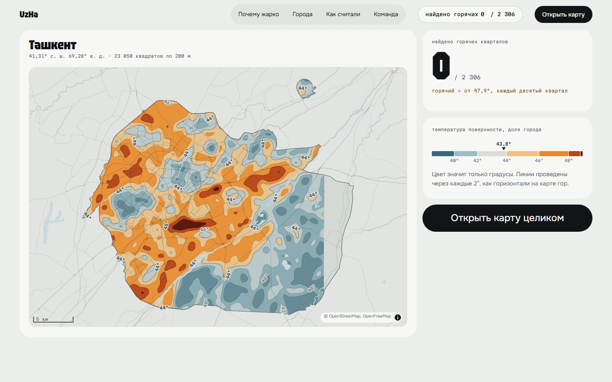
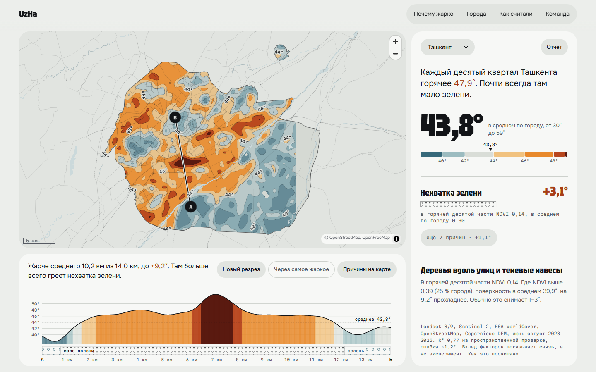
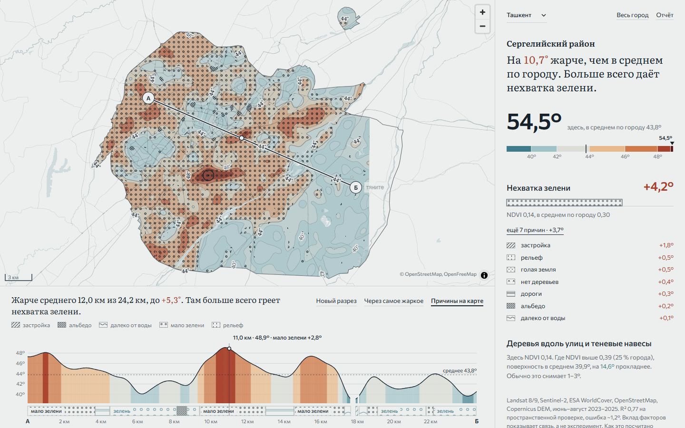
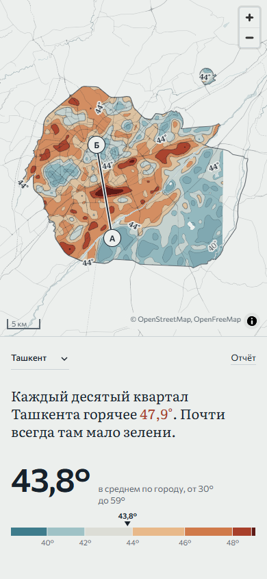

# UzHa: острова тепла городов Узбекистана

Карта летнего перегрева Ташкента, Самарканда и Бухары по спутниковым снимкам. Для каждого участка 200 × 200 м
показывает, насколько там горячо, что именно греет это место и что с этим можно сделать.

**Сайт:** https://uzha.mydevbox.xyz



## Что получилось

Поверхность внутри черты города летом горячее, чем в кольце вокруг:

| | Остров тепла | Средняя поверхность | Точность модели (R², пространственная проверка) |
|---|---|---|---|
| Ташкент | +1,8° | 43,6° | 0,77 |
| Самарканд | +1,4° | 42,7° | 0,76 |
| Бухара | +3,1° | 41,4° | 0,68 |

Везде сильнее всего на температуру влияет зелень, но горячие места у городов разные. В Ташкенте это плотная
застройка без деревьев. В Самарканде открытая, почти незастроенная земля. В Бухаре застройка вперемешку с голым грунтом.

Это температура самой поверхности по снимкам около 11 утра, а не температура воздуха.

На самых горячих участках, в горячей десятой части, живут около 323 тыс. человек в Ташкенте и 16 тыс. в Самарканде.
Это оценка WorldPop 2025: модель по переписи и застройке, а не подсчёт людей.

## Как пользоваться



- Цвет означает только градусы, линии проведены через каждые 2°.
- Щелчок по месту показывает его температуру, главную причину и меру, которая подходит именно здесь.
- Линия А–Б строит разрез: профиль температуры и полосу причин под ним. Причины нарисованы штриховкой.
- «Люди» показывает точками, сколько человек живёт на участке, и значками школы, детские сады и поликлиники
  на самых горячих участках. Цвет при этом остаётся только температурой.
- «Отчёт» собирает страницу для печати. Данные города можно скачать в CSV или GeoJSON.



На телефоне:



## Как посчитано

1. Сетка 200 м в зоне UTM города, граница города из OpenStreetMap и кольцо 1,5 км вокруг.
2. Температура поверхности: медиана безоблачных снимков Landsat 8/9 (NASA/USGS, Collection 2 Level-2),
   июнь–август 2023–2025.
3. Факторы: зелень (NDVI) и альбедо по Sentinel-2, доли деревьев, застройки и голого грунта по ESA WorldCover,
   высота по Copernicus DEM, дороги, здания и вода из OpenStreetMap.
4. Модель XGBoost. Точность проверена на целых блоках 2 × 2 км, которых модель не видела.
5. Вклад каждого фактора в каждом участке считается через SHAP, в градусах.

Подробнее: [pipeline/README.md](pipeline/README.md), формат данных: [docs/data-contract.md](docs/data-contract.md),
зачем это нужно: [docs/problem.md](docs/problem.md).

Ограничения. Снимки сделаны около 11 утра, ночной жары они не видят. Вклад факторов показывает связь, найденную
моделью, а не результат эксперимента. Эффект мер оценён по опубликованным исследованиям, ссылки есть прямо в карточках.

## Запуск

Сайт (статический, без бэкенда):

```bash
cd web
npm ci
npm run dev        # http://localhost:5173
npm test
npm run build      # результат в web/dist
```

Пересчёт данных (Python 3.10+, ключи не нужны):

```bash
pip install -r pipeline/requirements.txt
PYTHONUTF8=1 python -m pipeline.run --all     # или --city tashkent
python -m pytest pipeline/tests -q
```

Готовые данные лежат в `web/public/data/`, так что для сайта пайплайн запускать не обязательно.
Хостинг описан в [docs/deploy.md](docs/deploy.md).

## Стек

Python, rasterio, XGBoost, Microsoft Planetary Computer · Vite, React, TypeScript, MapLibre GL, d3-contour, Vitest ·
nginx и Cloudflare Tunnel.

## Команда

Амира, Олия, Макс, rabenvater, Степан.
