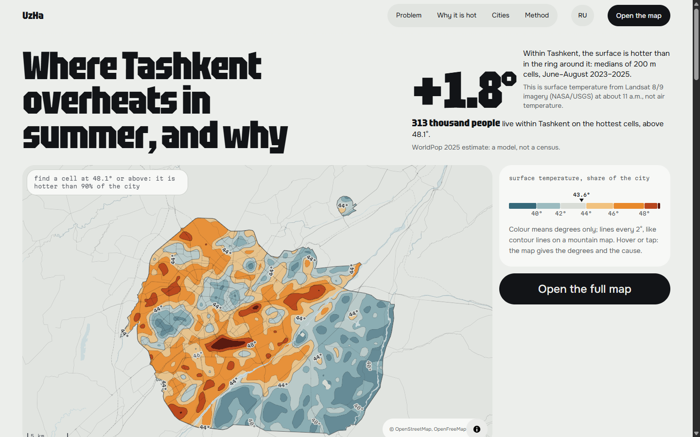
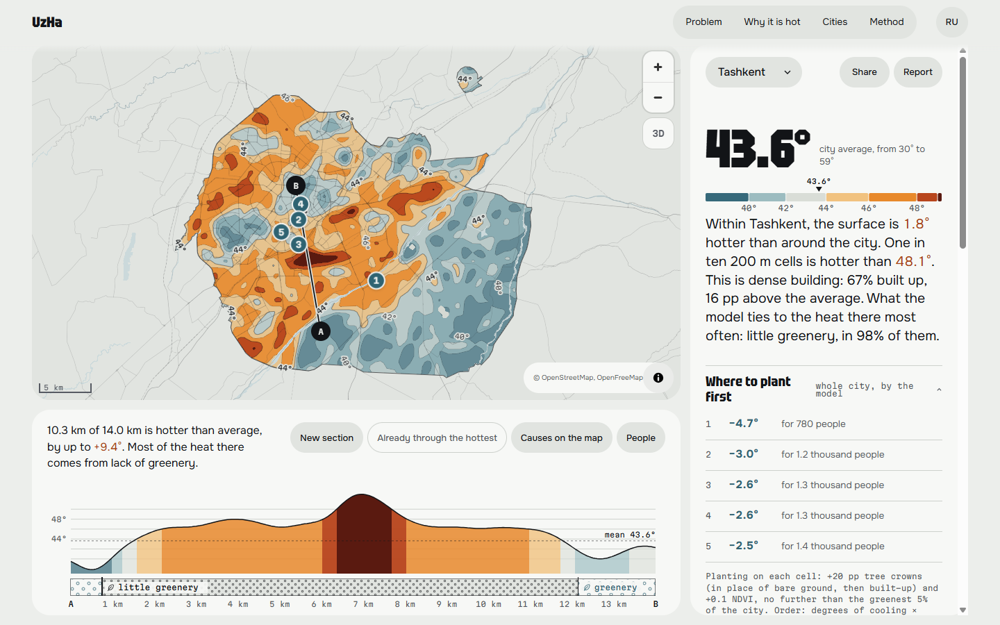
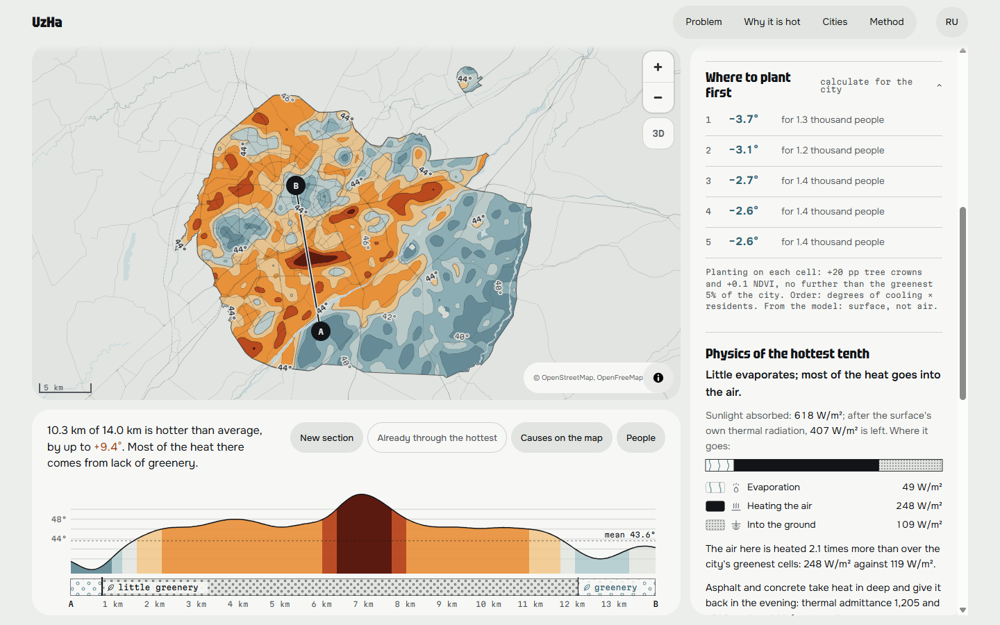
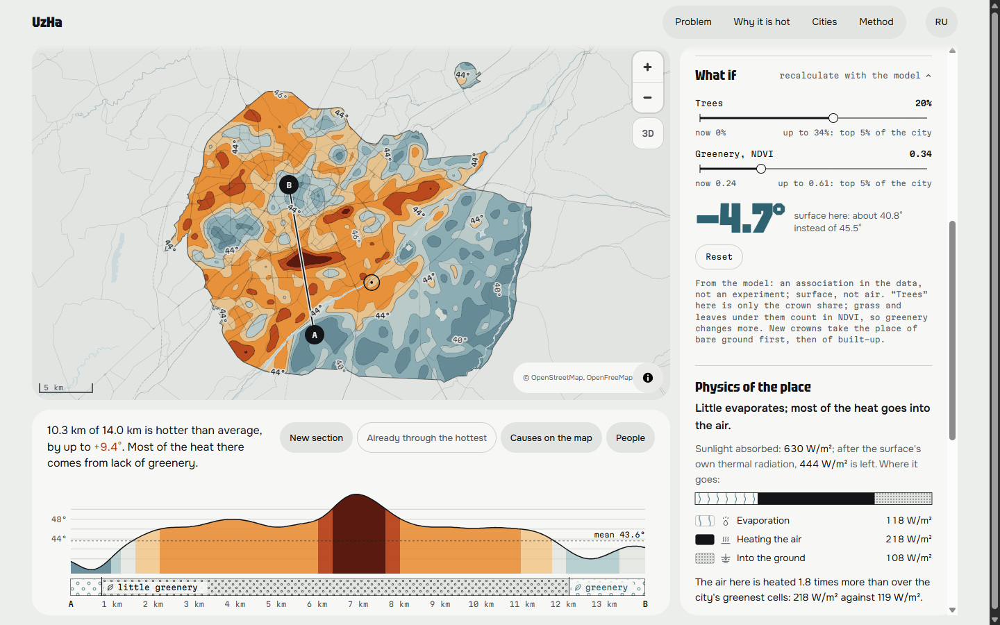
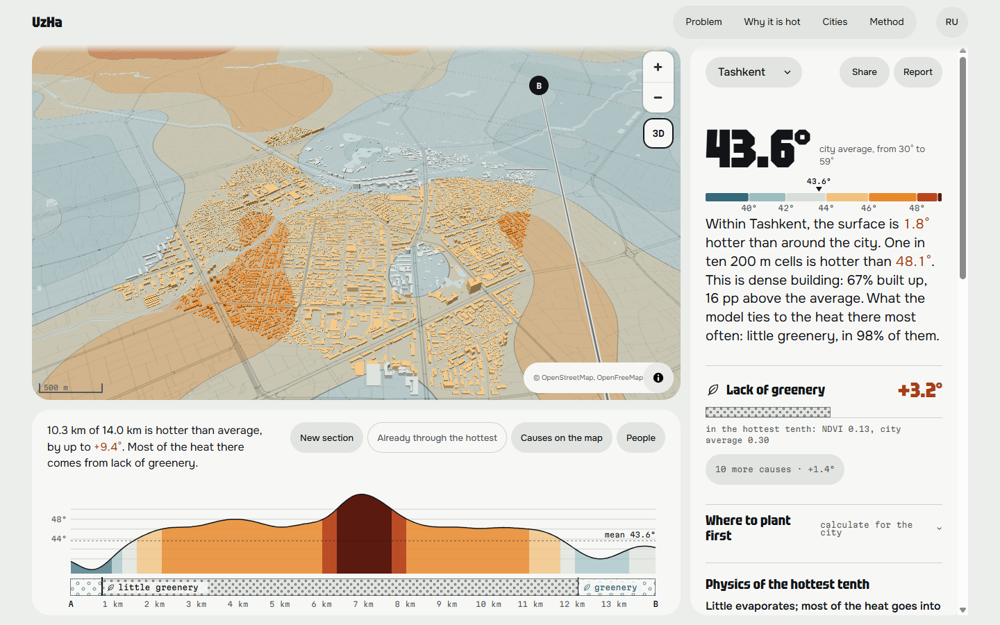
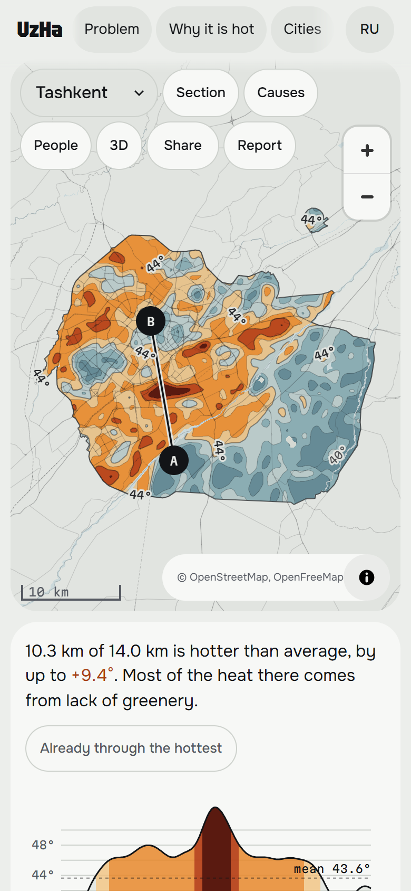

# UzHa: urban heat islands of Uzbek cities

**English** · [Русский](README.ru.md)

**Team:** UzHa · **Challenge:** Urban Heat Islands of Tashkent (Uzspace Hackathon 2026, GIS & AI)

**Live demo:** https://uzha.mydevbox.xyz

**How to view the demo** (two minutes):
1. Open https://uzha.mydevbox.xyz/map/tashkent and click any coloured place on the map.
2. In the panel on the right move the "What if" sliders: the city model recalculates that place.
3. Click "Whole city", then "Where to plant first": five places, each opens on the map.

A map of summer surface overheating in Tashkent, with Samarkand and Bukhara as a check that the method transfers. For every
200 × 200 m cell it shows how hot the surface is, which factors heat or cool that place and by how many degrees, and what
can be done there. "What if" sliders recompute the temperature of a place with the city's own model right in the browser,
"Where to plant first" ranks places by cooling × residents, and a 3D view colours about 660 thousand buildings
by the surface temperature under them.



## Results

Inside the city outline the surface is hotter in summer than in the ring around it:

| | Heat island | With a ring of 0.5 / 1 / 1.5 km | Mean surface inside the outline | Variance explained (R² on blocks the model never saw) |
|---|---|---|---|---|
| Tashkent | +1.8 °C | +1.3 / +1.5 / +1.8 °C | 43.9 °C | 79 % |
| Samarkand | +1.4 °C | +1.2 / +1.2 / +1.4 °C | 43.4 °C | 77 % |
| Bukhara | +3.1 °C | +2.9 / +3.0 / +3.1 °C | 42.7 °C | 69 % |

Heat island: median of the cells inside the outline minus the median of the ring around it. Its sign and size do not depend
on the ring width.

NDVI is the single strongest factor in all three cities; in Samarkand built-up land is close behind (37 % against 39 %
for vegetation and soil). Grouping correlated factors, vegetation and bare soil take 39–64 % of the
mean contribution inside the outline, built-up land 21–37 %. The hot places differ by city: dense building without trees in
Tashkent, open nearly unbuilt land in Samarkand, building mixed with bare ground in Bukhara.

This is the temperature of the surface itself at about 11:00, from satellite images, not the air temperature.

**Check against NASA MODIS** (1 km, same summers, Tashkent / Samarkand / Bukhara):

| | Overpass | Pattern, r | Mean difference, ours minus MODIS | RMSE |
|---|---|---|---|---|
| Terra (MOD11A2) | ~10:30, closer to Landsat's ~11:00 | 0.87 / 0.65 / 0.87 | +4.4 / +3.2 / +3.3 °C | 4.7 / 3.8 / 3.7 °C |
| Aqua (MYD11A2) | ~13:30 | 0.85 / 0.61 / 0.81 | +0.4 / −0.6 / −0.7 °C | 1.7 / 2.1 / 1.8 °C |

The main metric is r: it says whether we find the heat in the same places. The absolute level differs between the
products for known reasons: emissivity, 30 m Landsat against 1 km MODIS, view angle and time of day.

MODIS at 1 km also puts the city above its 1.5 km ring: by day +2.0 / +1.6 / +2.1 °C (Terra) and +2.3 / +2.0 / +2.5 °C
(Aqua), at night (Aqua, about 01:30) +2.4 / +1.2 / +1.8 °C. So Tashkent's +1.8 °C is not a Landsat artefact. In Samarkand
and Bukhara the night island is smaller than the day one.
Command: `PYTHONUTF8=1 python -m pipeline.validate --all --web`.

**People in the heat.** About 313 thousand people in Tashkent, 55 thousand in Bukhara and about 7 thousand in Samarkand live
in the hottest 10% of cells inside the outline. In Samarkand the hottest cells are mostly empty open land, hence the small
figure. Population is the WorldPop 2025 model (census plus buildings), not a head count.

**Where to plant first.** The same greening on every inhabited 200 m cell: tree crowns plus grass and watering, that is
+20 percentage points of tree crown and +0.1 NDVI (never past the city's 95th percentile), run through the city model. In
Tashkent the model gives the top five places a 2.6–3.7 °C cooler surface, for roughly 1.2–1.4 thousand residents each.
The ranking is cooling × residents, not how hot the cell is today: the first place, near the Small Ring Road, is an
average block (43.5 °C; mean inside the outline 43.9 °C) with low NDVI (0.14) and about 1,300 residents. There: crowns only −0.5 °C,
NDVI only −3.1 °C, both −3.7 °C (surface 43.5 → 39.9 °C).

On the surface most of it shows up as greenery (NDVI), not crowns. A survey of 30 green squares in Tashkent (Mukhamedjanov et al.,
2024) found crown area cools most and lawns barely; that study measured air at 1.5 m, between 12:00 and 15:00. We map the
surface at about 11:00: watered grass cools the surface by evaporation, crowns cool the air by shade. And ESA WorldCover
labels each 10 m pixel by its main class, so narrow rows of street trees can end up as built-up; their leaves then show
up in NDVI rather than in the tree share.

## How to use it



- Colour means degrees only; isotherms every 2 °C.
- Click a place: its temperature, the main cause and the measure that fits this place.
- Line A–B draws a cross-section: the temperature profile and a band of causes under it (hatched).
- "People" shows residents as dots, and schools, kindergartens and clinics on the hottest cells. Colour stays temperature.
- "3D" tilts the map and raises the buildings, each coloured by the surface temperature under it.
- "What if" on a place: more tree crown and greenery (NDVI), lighter roofs, and, where built-up land or roads heat that place,
  less of them. The city model recomputes the surface temperature of that place. Sliders stay within what the city already has
  (5–95 % of cells); built-up can drop by at most 25 percentage points.
- "Where to plant first" on the city view: five places, numbered on the map; each opens with its own "what if".
- "Share" puts the place and the 3D view into the link. "Report" builds a printable page; city data downloads as CSV or GeoJSON.

| Where to plant first | What if, place 1 |
|---|---|
|  |  |

| 3D buildings | On a phone |
|---|---|
|  |  |

## Method

1. A 200 m grid in the city's UTM zone, the city outline from OpenStreetMap and a 1.5 km ring around it.
2. Land surface temperature: median of cloud-free Landsat 8/9 scenes (NASA/USGS, Collection 2 Level-2), June–August 2023–2025.
3. Factors: greenery (NDVI) and albedo from Sentinel-2; shares of trees, built-up and bare soil from ESA WorldCover;
   elevation from Copernicus DEM; roads, buildings and water from OpenStreetMap.
4. An XGBoost model per city. Accuracy is measured on whole 2 × 2 km blocks left out of training (spatial cross-validation).
5. The contribution of every factor in every cell, in °C, from SHAP.
6. Checks: the heat island with rings of 0.5 / 1 / 1.5 km, groups of correlated factors, NASA MODIS Terra and Aqua by day
   and by night.
7. Buildings for 3D: footprints from OpenStreetMap and Microsoft ML Building Footprints; height from OSM, otherwise modelled
   from shape, type, neighbours and GHSL Built-H. Mean error on held-out buildings: Tashkent 3.9 m, Samarkand 1.4 m, Bukhara 2.4 m.
8. Each city model is exported as compact JSON for "what if"; the browser evaluates it exactly as XGBoost does
   (difference below 0.00001 °C, tested).

More: [pipeline/README.md](pipeline/README.md), data format: [docs/data-contract.md](docs/data-contract.md),
why this matters: [docs/problem.md](docs/problem.md).

**Limitations.** Landsat passes at about 11:00; the night heat island is estimated only from MODIS at 1 km. Factor
contributions and "what if" show an association found by the model, not the result of an experiment. Most building heights
are modelled, so for a single house they are an estimate. Microsoft has no footprints for Bukhara, so only OSM buildings there.
Measure effects come from published studies, linked in the cards.

## Data sources

| Data | Source | Used for |
|---|---|---|
| Land surface temperature | [Landsat 8/9 Collection 2 Level-2](https://planetarycomputer.microsoft.com/dataset/landsat-c2-l2), NASA/USGS | target |
| NDVI, albedo | [Sentinel-2 L2A](https://planetarycomputer.microsoft.com/dataset/sentinel-2-l2a), ESA Copernicus | factors |
| Land cover | [ESA WorldCover 10 m](https://planetarycomputer.microsoft.com/dataset/esa-worldcover) | trees, built-up, bare soil |
| Elevation | [Copernicus DEM GLO-30](https://planetarycomputer.microsoft.com/dataset/cop-dem-glo-30) | factor |
| Roads, buildings, water, outlines, facilities | [OpenStreetMap](https://www.openstreetmap.org) | factors, map |
| Building footprints | [Microsoft ML Building Footprints](https://github.com/microsoft/GlobalMLBuildingFootprints) | 3D |
| Building height | [GHSL Built-H](https://human-settlement.emergency.copernicus.eu/) | 3D height model |
| Population | [WorldPop](https://www.worldpop.org) 2025 | people in the heat, planting ranking |
| Validation | NASA MODIS [MOD11A2](https://lpdaac.usgs.gov/products/mod11a2v061/) (Terra) and [MYD11A2](https://lpdaac.usgs.gov/products/myd11a2v061/) (Aqua), day and night | check |
| Weather context | ERA5 (Copernicus) via [Open-Meteo](https://open-meteo.com) | wind, humidity, sun |
| Basemap | [OpenFreeMap](https://openfreemap.org) | map tiles |

All sources are open; no API keys are needed.

## Run it

**Website** (static, no backend; Node 20+):

```bash
cd web
npm ci
npm run dev        # http://localhost:5173
npm test           # unit tests (Vitest)
npm run build      # output in web/dist
```

The city JSON files and models are already in `web/public/data/`, so the site runs without the pipeline. Building files
`.fgb` (about 140 MB) are not in git; without them 3D shows the basemap's buildings. To get them without running the
pipeline, download the published ones:

```bash
mkdir -p web/public/data/buildings
for c in tashkent samarkand bukhara; do
  curl -o web/public/data/buildings/$c.fgb https://uzha.mydevbox.xyz/data/buildings/$c.fgb
done
```

Commands are for bash or Git Bash. In PowerShell set `$env:PYTHONUTF8=1` and use `curl.exe`.

**Data pipeline** (Python 3.10+, no keys):

```bash
pip install -r pipeline/requirements.txt
PYTHONUTF8=1 python -m pipeline.run --all              # map, model and model-<city>.json; or --city tashkent
PYTHONUTF8=1 python -m pipeline.validate --all --web   # MODIS check, night, rings
PYTHONUTF8=1 python -m pipeline.buildings              # buildings for 3D (downloads OSM and Microsoft footprints)
python -m pytest pipeline/tests -q                     # 109 tests, one to two minutes
```

The pipeline reads Landsat and Sentinel-2 from Microsoft Planetary Computer and caches every layer in `pipeline/cache/`.
A first run of Tashkent takes roughly 10–20 minutes, mostly Sentinel-2 reads; a rerun with the cache takes about a minute.
`pipeline.buildings` downloads the Geofabrik extract of Uzbekistan (~130 MB), Microsoft footprints (~45 MB per tile) and a
GHSL tile. Details: [pipeline/README.md](pipeline/README.md).

**Checking against data you hand us** (offline, seconds; reads `web/public/data/<city>.json`):

```bash
PYTHONUTF8=1 python -m pipeline.compare --city tashkent --points stations.csv   # lon/lat columns found by name
PYTHONUTF8=1 python -m pipeline.compare --city tashkent --raster their_lst.tif  # any CRS and resolution
```

Points go to the 200 m cell they fall in (the value column is found automatically, or `--value t_max`; `;` and
decimal commas are fine). A raster finer than our cells is averaged into each cell; a coarser one is compared at its own
pixels, our cells averaged into them. Kelvin is detected; `--scale` and `--offset` undo scaled integers. It prints
n, Pearson r, Spearman ρ, mean difference, RMSE and how much of our hottest 10 % is also in theirs, and writes
`pipeline/cache/compare-<city>-<file>.json`. For air temperature the difference is expected; r and the hottest-10 %
overlap say whether the heat is in the same places.

Hosting: [docs/deploy.md](docs/deploy.md).

## Dependencies

- **Pipeline:** Python 3.10+, numpy, pandas, scipy, rasterio, pyproj, shapely, pyogrio, pystac-client, planetary-computer,
  xgboost, scikit-learn, requests, pytest (`pipeline/requirements.txt`).
- **Web:** Node 20+, React 18, TypeScript 5.6, Vite 5, MapLibre GL 6, FlatGeobuf, d3-contour, Vitest (`web/package.json`).
- **Hosting:** nginx and Cloudflare Tunnel.

## Team

| Member | Role |
|---|---|
| Stepan | ROLE |
| Amira | ROLE |
| Oliya | ROLE |
| Maksim | ROLE |
| Shakhina | ROLE |

How we work with code and git: [CONTRIBUTING.md](CONTRIBUTING.md).
