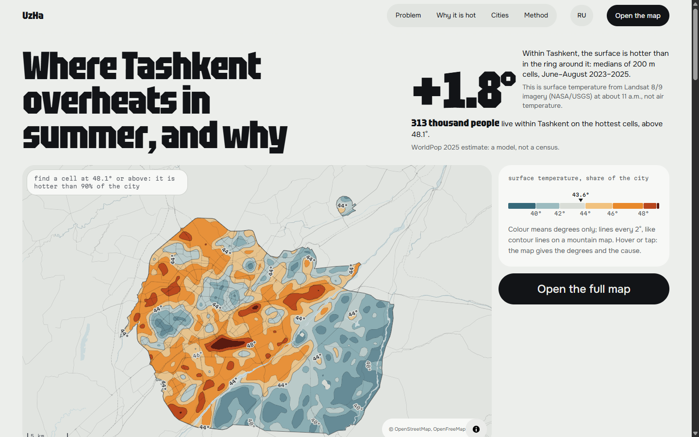
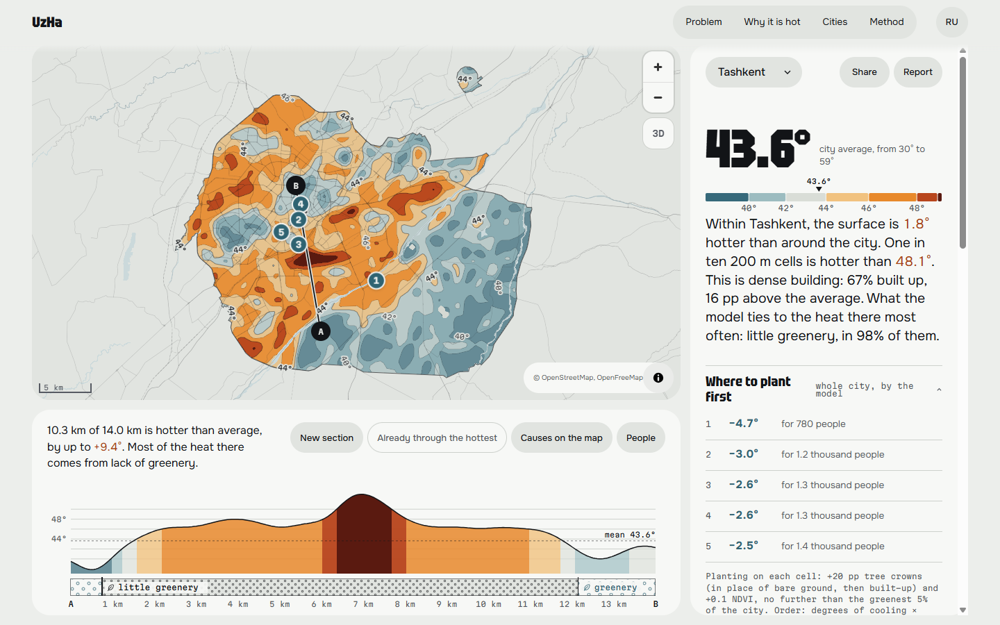
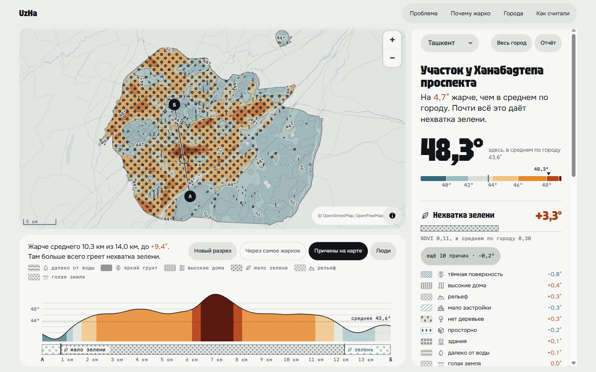
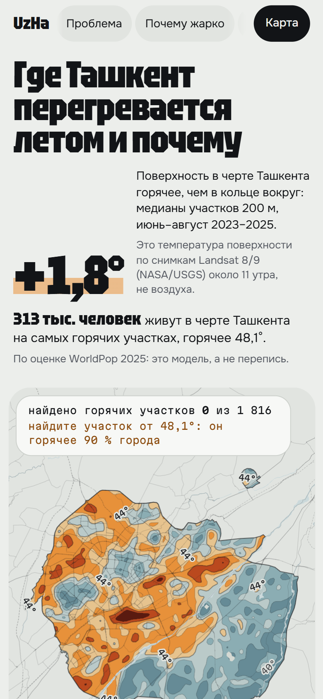

# UzHa: острова тепла городов Узбекистана

[English](README.md) · **Русский**

Карта летнего перегрева Ташкента, Самарканда и Бухары по спутниковым снимкам Landsat 8/9 (NASA/USGS). Для каждого участка 200 × 200 м
показывает, насколько там горячо, что именно греет это место и что с этим можно сделать, а в 3D показывает город, где каждый дом
окрашен температурой поверхности под ним. Ползунки «что если» пересчитывают температуру участка той же моделью прямо в браузере.

**Сайт:** https://uzha.mydevbox.xyz



## Что получилось

Поверхность внутри черты города летом горячее, чем в кольце вокруг:

| | Остров тепла | При кольце 0,5 / 1 / 1,5 км | Средняя поверхность | Модель объясняет разброса (R² на блоках, которых не видела) |
|---|---|---|---|---|
| Ташкент | +1,8° | +1,3 / +1,5 / +1,8° | 43,6° | 79 % |
| Самарканд | +1,4° | +1,2 / +1,2 / +1,4° | 42,7° | 77 % |
| Бухара | +3,1° | +2,9 / +3,0 / +3,1° | 41,4° | 69 % |

Остров тепла: медиана участков в черте города минус медиана кольца вокруг. Знак и порядок числа не зависят от ширины кольца.

Везде сильнее всего с температурой связана зелень. Даже если сложить вклады связанных факторов в группы, на растительность
и грунт приходится 39–64 % среднего вклада по участкам в черте города, на застройку 21–37 %. Но горячие места у городов разные. В Ташкенте это плотная
застройка без деревьев. В Самарканде открытая, почти незастроенная земля. В Бухаре застройка вперемешку с голым грунтом.

Это температура самой поверхности по снимкам около 11 утра, а не температура воздуха.

Сверка с NASA MODIS (MYD11A2, 1 км, то же лето): рисунок совпадает с r = 0,85 / 0,61 / 0,81, средняя разница
+0,4 / −0,6 / −0,7°. Ночью (около 01:30) город по MODIS тоже теплее кольца 1,5 км: +2,4 / +1,2 / +1,8°.
Команда: `python -m pipeline.validate --all --web`.

На самых горячих участках, в горячей десятой части, в черте города живут около 313 тыс. человек в Ташкенте, 55 тыс. в Бухаре
и около 7 тыс. в Самарканде. Кольцо вокруг города сюда не входит. В Самарканде самые горячие участки почти без жилья:
это пустая открытая земля, поэтому цифра маленькая.
Это оценка WorldPop 2025: модель по переписи и застройке, а не подсчёт людей.

## Как пользоваться



- Цвет означает только градусы, линии проведены через каждые 2°.
- Щелчок по месту показывает его температуру, главную причину и меру, которая подходит именно здесь.
- Линия А–Б строит разрез: профиль температуры и полосу причин под ним. Причины нарисованы штриховкой.
- «Люди» показывает точками, сколько человек живёт на участке, и значками школы, детские сады и поликлиники
  на самых горячих участках. Цвет при этом остаётся только температурой.
- «3D» наклоняет карту и поднимает дома: около 660 тыс. зданий трёх городов, каждое в цвете температуры поверхности под ним.
- «Что если» на панели участка: больше деревьев и зелени, светлые крыши, меньше застройки. Модель города пересчитывает
  температуру поверхности этого места. Ползунки не выходят за то, что в городе уже есть (5–95 % участков), застройку можно
  уменьшить не больше чем на 25 п.п.
- «Отчёт» собирает страницу для печати. Данные города можно скачать в CSV или GeoJSON.



На телефоне:



## Как посчитано

1. Сетка 200 м в зоне UTM города, граница города из OpenStreetMap и кольцо 1,5 км вокруг.
2. Температура поверхности: медиана безоблачных снимков Landsat 8/9 (NASA/USGS, Collection 2 Level-2),
   июнь–август 2023–2025.
3. Факторы: зелень (NDVI) и альбедо по Sentinel-2, доли деревьев, застройки и голого грунта по ESA WorldCover,
   высота по Copernicus DEM, дороги, здания и вода из OpenStreetMap.
4. Модель XGBoost. Точность проверена на целых блоках 2 × 2 км, которых модель не видела.
5. Вклад каждого фактора в каждом участке считается через SHAP, в градусах.
6. Проверка: остров тепла при кольце 0,5 / 1 / 1,5 км, группы связанных факторов и сверка с NASA MODIS днём и ночью
   (`python -m pipeline.validate --all --web`).
7. Здания для 3D: контуры OpenStreetMap и Microsoft ML Building Footprints, высота из OSM, а где её нет, по модели
   как в проекте Soya (форма, тип, соседи, GHSL Built-H). Средняя ошибка на отложенных зданиях: Ташкент 3,9 м, Самарканд 1,4 м,
   Бухара 2,4 м (`python -m pipeline.buildings`, файлы `web/public/data/buildings/<город>.fgb`).
8. Модель каждого города выгружена компактным JSON для «что если»; браузер считает так же, как XGBoost (расхождение меньше 0,0001°).

Подробнее: [pipeline/README.md](pipeline/README.md), формат данных: [docs/data-contract.md](docs/data-contract.md),
зачем это нужно: [docs/problem.md](docs/problem.md).

Ограничения. Landsat снимает около 11 утра; ночной остров тепла оценён только по MODIS с шагом 1 км. Вклад факторов
и «что если» показывают связь, найденную моделью, а не результат эксперимента. Высоту большинства домов модель оценивает
по форме и соседям, для отдельного дома это оценка. У Microsoft нет контуров по Бухаре, там дома только из OSM.
Эффект мер оценён по опубликованным исследованиям, ссылки есть прямо в карточках.

## Запуск

Сайт (статический, без бэкенда):

```bash
cd web
npm ci
npm run dev        # http://localhost:5173
npm test
npm run build      # результат в web/dist
```

Пересчёт данных (Python 3.10+, ключи не нужны):

```bash
pip install -r pipeline/requirements.txt
PYTHONUTF8=1 python -m pipeline.run --all        # карта, модель и model-<город>.json; или --city tashkent
PYTHONUTF8=1 python -m pipeline.validate --all --web   # сверка с MODIS, ночь, кольца
PYTHONUTF8=1 python -m pipeline.buildings        # здания для 3D (скачивает выгрузку OSM и контуры Microsoft)
python -m pytest pipeline/tests -q
```

Готовые JSON городов и модели лежат в `web/public/data/`, так что для сайта пайплайн запускать не обязательно. Файлы
зданий `.fgb` (около 140 МБ) в git не входят: без них 3D показывает дома подложки OpenFreeMap.
Хостинг описан в [docs/deploy.md](docs/deploy.md).

## Стек

Python, rasterio, XGBoost, scikit-learn, GDAL, Microsoft Planetary Computer · Vite, React, TypeScript, MapLibre GL,
FlatGeobuf, d3-contour, Vitest · nginx и Cloudflare Tunnel.

## Участие

Как устроена работа с кодом и git: [CONTRIBUTING.md](CONTRIBUTING.md).

## Команда

Амира, Олия, Максим, Шахина, Степан.
