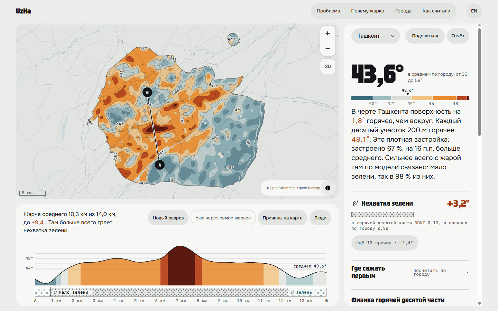
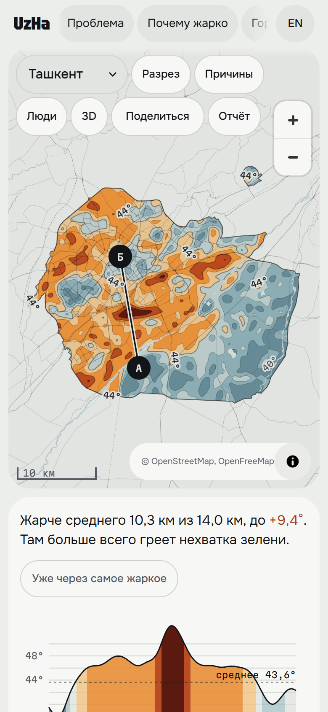

# UzHa: острова тепла городов Узбекистана

[English](README.md) · **Русский**

**Команда:** UzHa · **Задача:** Urban Heat Islands of Tashkent (Uzspace Hackathon 2026, GIS & AI)

**Сайт:** https://uzha.mydevbox.xyz

**Как посмотреть демо** (две минуты):
1. Откройте https://uzha.mydevbox.xyz/map/tashkent?lang=ru и нажмите на любое цветное место на карте.
2. На панели справа подвигайте ползунки «Что если»: модель города пересчитает это место.
3. Под ответом по городу блок «Где сажать первым»: пять мест, пронумерованных на карте (на широком экране открыт сразу,
   на телефоне нажмите на него). Каждое открывается со своим «Что если».

Карта летнего перегрева поверхности Ташкента; тот же пайплайн посчитан для Самарканда и Бухары (у каждого города своя модель). Для каждого
участка 200 × 200 м видно, насколько горячая поверхность, какие факторы греют или охлаждают это место и на сколько градусов,
и что здесь можно сделать. Ползунки «Что если» пересчитывают температуру места моделью самого города прямо в браузере,
«Где сажать первым» ранжирует места по охлаждению × числу жителей, а 3D окрашивает около 660 тыс. зданий
температурой поверхности под ними.


## Что получилось

Внутри черты города поверхность летом горячее, чем в кольце вокруг:

| | Остров тепла | При кольце 0,5 / 1 / 1,5 км | Средняя поверхность в черте города | Доля объяснённого разброса (R² на блоках, которых модель не видела) |
|---|---|---|---|---|
| Ташкент | +1,8 °C | +1,3 / +1,5 / +1,8 °C | 43,9 °C | 79 % |
| Самарканд | +1,4 °C | +1,2 / +1,2 / +1,4 °C | 43,4 °C | 77 % |
| Бухара | +3,1 °C | +2,9 / +3,0 / +3,1 °C | 42,7 °C | 69 % |

Остров тепла: медиана участков в черте города минус медиана кольца вокруг. Знак сохраняется при любой ширине кольца,
а величина с шириной растёт (Ташкент +1,3 → +1,8 °C от 0,5 до 1,5 км), и по MODIS она растёт дальше, до 5 км, в Ташкенте
и Самарканде (Самарканд днём +1,6 → +3,0 °C). Кольцо 1,5 км само отчасти пригородное, так что это оценки снизу.

Самый сильный отдельный фактор во всех трёх городах — NDVI; в Самарканде застройка почти вровень с ним (37 % против 39 %
у растительности и грунта). Если сложить связанные факторы в группы, на растительность и голый грунт приходится 39–64 %
среднего вклада в черте города, на застройку 21–37 %. Горячие места у городов разные: в Ташкенте плотная застройка без деревьев,
в Самарканде открытая, почти незастроенная земля, в Бухаре застройка вперемешку с голым грунтом.

Это температура самой поверхности около 11:00 по спутниковым снимкам, а не температура воздуха.

**Сверка с NASA MODIS** (1 км, те же лета, Ташкент / Самарканд / Бухара):

| | Пролёт | Совпадение рисунка, r | Средняя разница, наша минус MODIS | RMSE |
|---|---|---|---|---|
| Terra (MOD11A2) | ~10:30, ближе к ~11:00 Landsat | 0,87 / 0,65 / 0,87 | +4,4 / +3,2 / +3,3 °C | 4,7 / 3,8 / 3,7 °C |
| Aqua (MYD11A2) | ~13:30 | 0,85 / 0,61 / 0,81 | +0,4 / −0,6 / −0,7 °C | 1,7 / 2,1 / 1,8 °C |

Главная метрика — r: она показывает, находим ли мы жару в тех же местах. Абсолютный уровень у продуктов расходится по известным
причинам: излучательная способность, тепловой канал Landsat (100 м, выдан на сетке 30 м) против 1 км MODIS, угол съёмки
и время суток. Terra пролетает ближе всего ко времени Landsat, поэтому её +3…+4 °C — честная мера разницы уровня;
меньшая разница с Aqua отчасти объясняется её более поздним и горячим пролётом, а не лучшим совпадением.

Рисунок совпадает и внутри одной городской границы, то есть дело не только в контрасте города и пригорода: на
734 / 124 / 121 пикселях MODIS внутри границы r = 0,87 / 0,67 / 0,86 (Terra) и 0,85 / 0,61 / 0,78 (Aqua).

MODIS с шагом 1 км тоже ставит город выше кольца 1,5 км: днём +2,0 / +1,6 / +2,1 °C (Terra) и +2,3 / +2,0 / +2,5 °C
(Aqua), ночью (Aqua, около 01:30) +2,4 / +1,2 / +1,8 °C. Значит, +1,8 °C Ташкента не артефакт Landsat. В Самарканде
и Бухаре ночной остров меньше дневного.
Команда: `PYTHONUTF8=1 python -m pipeline.validate --all --web`.

**Насколько доверять модели** (R² на отложенных участках; Ташкент / Самарканд / Бухара):

| Проверка | R² |
|---|---|
| XGBoost, отложенные блоки 2 км (опубликованная оценка) | 0,79 / 0,77 / 0,69 |
| то же, только участки в черте города | 0,80 / 0,78 / 0,68, MAE 1,3 / 1,0 / 1,4 °C |
| то же, только участки кольца 1,5 км | 0,74 / 0,74 / 0,51 |
| XGBoost, отложенные блоки 1 км | 0,80 / 0,80 / 0,71 |
| XGBoost, отложенные блоки 4 км (осторожная оценка) | 0,77 / 0,75 / 0,67 |
| XGBoost, блоки 2 км, в обучении нет участков ближе 400 м к отложенным | 0,78 / 0,73 / 0,66 |
| XGBoost, случайные участки (не пространственно, для сравнения: завышает) | 0,82 / 0,83 / 0,76 |
| Линейная модель, все факторы, блоки 2 км | 0,67 / 0,55 / 0,60 |
| Линейная модель, только NDVI, блоки 2 км | 0,65 / 0,35 / 0,50 |

Опубликованная оценка (блоки 2 км) теряет 0,01–0,04 с буфером и чуть больше на крупных блоках, так что её держат
не соседние участки; модель даёт на 0,09–0,22 больше линейной. В черте города, где читатель что-то меняет, она не
слабее, чем в пригороде; её обычная ошибка там, 1,0–1,4 °C, сравнима со многими отдельными изменениями в «Что если»,
поэтому их стоит читать как направление и порядок величины. Команда: `python -m pipeline.cv_check --all`
(только опубликованные данные, меньше минуты).

**Люди в жаре.** Около 313 тыс. человек в Ташкенте, 55 тыс. в Бухаре и около 7 тыс. в Самарканде живут в черте города
на участках горячее 48,1 / 45,6 / 47,0 °C — самой горячей десятой части всей карты (город плюс кольцо 1,5 км). Если брать
самую горячую десятую часть участков только самого города, выйдет около 260, 27 и 5 тыс. В Самарканде самые горячие участки —
в основном пустая открытая земля, поэтому число маленькое.
Население — модель WorldPop 2025 (перепись плюс застройка), а не подсчёт людей.

**Где сажать первым.** Одно и то же озеленение на каждом жилом участке 200 м: кроны деревьев плюс трава и полив, то есть
+20 п.п. кроны и +0,1 NDVI (не выше 95-го перцентиля города), через модель города. Новые кроны занимают место сначала голого
грунта, потом застройки, так что доли покрытия участка никогда не превышают 100 %. В Ташкенте модель даёт первым пяти местам
поверхность на 2,5–4,7 °C прохладнее, примерно для 0,8–1,4 тыс. жителей каждое. Порядок — охлаждение × жители, а не то, насколько
участок горячий сегодня. Первое место, в Бектемирском районе, — плотный квартал (93 % застройки, деревьев нет, NDVI 0,24)
с поверхностью 45,5 °C, на 1,6 °C выше среднего в черте города (43,9 °C), и примерно 780 жителями. Там: только кроны −1,3 °C, только NDVI
−3,7 °C, вместе −4,7 °C (поверхность 45,5 → 40,8 °C).

На поверхности основная часть эффекта видна через зелень (NDVI), а не через кроны. Обследование 30 зелёных скверов Ташкента
(Mukhamedjanov et al., 2024) показало, что сильнее всего охлаждает площадь крон, а газоны почти нет; но там мерили воздух
на высоте 1,5 м между 12:00 и 15:00. Мы картируем поверхность около 11:00: политая трава охлаждает поверхность испарением,
кроны охлаждают воздух тенью. К тому же ESA WorldCover относит каждый пиксель 10 м к его основному классу, поэтому узкие ряды
уличных деревьев могут попасть в застройку; их листва тогда видна в NDVI, а не в доле деревьев.

## Как пользоваться



- Цвет означает только градусы; изотермы через каждые 2 °C.
- Нажмите на место: его температура, главная причина и мера, которая подходит именно здесь.
- Линия А–Б строит разрез: профиль температуры и полосу причин под ним (штриховкой).
- «Люди» показывает жителей точками, а школы, детские сады и поликлиники — на самых горячих участках. Цвет остаётся температурой.
- «3D» наклоняет карту и поднимает дома, каждый в цвете температуры поверхности под ним.
- «Что если» у места: больше крон и зелени (NDVI), а там, где это место греют застройка или дороги, — меньше их.
  Модель города пересчитывает температуру поверхности этого места. Ползунки не выходят за то, что в городе уже есть
  (5–95 % участков); застройку можно уменьшить не больше чем на 25 п.п.
- «Где сажать первым» на виде всего города: пять мест с номерами на карте; каждое открывается со своим «Что если».
- «Поделиться» кладёт место и вид 3D в ссылку. «Отчёт» собирает страницу для печати; данные города скачиваются в CSV или GeoJSON.

Скриншоты интерфейса на английском — в [README.md](README.md#how-to-use-it). На телефоне:



## Как посчитано

1. Сетка 200 м в зоне UTM города, граница города из OpenStreetMap и кольцо 1,5 км вокруг.
2. Температура поверхности: медиана безоблачных снимков Landsat 8/9 (NASA/USGS, Collection 2 Level-2), июнь–август 2023–2025.
3. Факторы: зелень (NDVI) и альбедо по Sentinel-2; доли деревьев, застройки и голого грунта по ESA WorldCover;
   высота по Copernicus DEM; дороги, здания и вода из OpenStreetMap.
4. Модель XGBoost для каждого города. Точность измерена на целых блоках 2 × 2 км, исключённых из обучения
   (пространственная кросс-валидация).
5. Вклад каждого фактора в каждом участке в °C — через SHAP.
6. Проверки: остров тепла при кольце 0,5 / 1 / 1,5 км, группы связанных факторов, NASA MODIS Terra и Aqua днём и ночью.
7. Здания для 3D: контуры из OpenStreetMap и Microsoft ML Building Footprints; высота из OSM, иначе по модели
   (форма, тип, соседи, GHSL Built-H). Средняя ошибка на отложенных зданиях: Ташкент 3,9 м, Самарканд 1,4 м, Бухара 2,4 м.
8. Модель каждого города выгружена компактным JSON для «Что если»; браузер считает её так же, как XGBoost
   (расхождение меньше 0,00001 °C, есть тест). Вклады факторов на карте взяты из той же модели, поэтому «Что если» в
   клетке начинается с той температуры, в которую складываются её вклады (с точностью 0,004 °C, округление файла).

Подробнее: [pipeline/README.md](pipeline/README.md), формат данных: [docs/data-contract.md](docs/data-contract.md),
зачем это нужно: [docs/problem.md](docs/problem.md).

**Ограничения.** Landsat снимает около 11:00; ночной остров тепла оценён только по MODIS с шагом 1 км. Вклады факторов
и «Что если» показывают связь, найденную моделью, а не результат эксперимента. Высота большинства зданий смоделирована,
для отдельного дома это оценка. У Microsoft нет контуров по Бухаре, там только здания OSM.
Эффект мер взят из опубликованных исследований, ссылки есть в карточках.

## Источники данных

| Данные | Источник | Для чего |
|---|---|---|
| Температура поверхности | [Landsat 8/9 Collection 2 Level-2](https://planetarycomputer.microsoft.com/dataset/landsat-c2-l2), NASA/USGS | целевая переменная |
| NDVI, альбедо | [Sentinel-2 L2A](https://planetarycomputer.microsoft.com/dataset/sentinel-2-l2a), ESA Copernicus | факторы |
| Покрытие земли | [ESA WorldCover 10 м](https://planetarycomputer.microsoft.com/dataset/esa-worldcover) | деревья, застройка, голый грунт |
| Рельеф | [Copernicus DEM GLO-30](https://planetarycomputer.microsoft.com/dataset/cop-dem-glo-30) | фактор |
| Дороги, здания, вода, границы, учреждения | [OpenStreetMap](https://www.openstreetmap.org) | факторы, карта |
| Контуры зданий | [Microsoft ML Building Footprints](https://github.com/microsoft/GlobalMLBuildingFootprints) | 3D |
| Высота зданий | [GHSL Built-H](https://human-settlement.emergency.copernicus.eu/) | модель высоты для 3D |
| Население | [WorldPop](https://www.worldpop.org) 2025 | люди в жаре, порядок посадки |
| Проверка | NASA MODIS [MOD11A2](https://lpdaac.usgs.gov/products/mod11a2v061/) (Terra) и [MYD11A2](https://lpdaac.usgs.gov/products/myd11a2v061/) (Aqua), день и ночь | сверка |
| Погода | ERA5 (Copernicus) через [Open-Meteo](https://open-meteo.com) | ветер, влажность, солнце |
| Подложка | [OpenFreeMap](https://openfreemap.org) | тайлы карты |

Все источники открытые; ключи API не нужны.

## Запуск

**Сайт** (статический, без бэкенда; Node 20+):

```bash
cd web
npm ci
npm run dev        # http://localhost:5173
npm test           # 329 юнит-тестов (Vitest), около 15 секунд
npm run build      # результат в web/dist
```

JSON городов и модели уже лежат в `web/public/data/`, так что сайт работает без пайплайна. Файлы зданий
`.fgb` (около 140 МБ) в git не входят; без них 3D показывает дома подложки. Чтобы получить их без пайплайна,
скачайте опубликованные (из корня проекта, не из `web/`):

```bash
mkdir -p web/public/data/buildings
for c in tashkent samarkand bukhara; do
  curl -o web/public/data/buildings/$c.fgb https://uzha.mydevbox.xyz/data/buildings/$c.fgb
done
```

Команды для bash или Git Bash. В PowerShell задайте `$env:PYTHONUTF8=1` и используйте `curl.exe`.

**Пайплайн данных** (Python 3.10+, без ключей):

```bash
python -m venv .venv && source .venv/bin/activate     # Git Bash: .venv/Scripts/activate; PowerShell: .venv\Scripts\Activate.ps1
pip install -r pipeline/requirements-lock.txt         # точные версии, с которыми мы считали; или requirements.txt
PYTHONUTF8=1 python -m pipeline.run --all              # карта, модель и model-<город>.json; или --city tashkent
PYTHONUTF8=1 python -m pipeline.validate --all --web   # сверка с MODIS, ночь, кольца
PYTHONUTF8=1 python -m pipeline.buildings              # здания для 3D (скачивает OSM и контуры Microsoft)
python -m pytest pipeline/tests -q                     # 121 тест, меньше минуты
```

Пайплайн читает Landsat и Sentinel-2 из Microsoft Planetary Computer и кеширует каждый слой в `pipeline/cache/`.
Каталог со временем пополняется и пересчитывается, поэтому новый полный прогон может взять немного другие снимки и дать
чуть другие числа; сайт и этот README показывают опубликованные JSON из `web/public/data/`.
Первый прогон Ташкента занимает примерно 10–20 минут, в основном чтение Sentinel-2; повторный с кешем — около минуты.
`pipeline.buildings` скачивает выгрузку Geofabrik по Узбекистану (~130 МБ), контуры Microsoft (~45 МБ на тайл) и тайл
GHSL. Подробнее: [pipeline/README.md](pipeline/README.md).

**Сверка с вашими данными** (офлайн, секунды; читает `web/public/data/<город>.json`):

```bash
PYTHONUTF8=1 python -m pipeline.compare --city tashkent --points pipeline/examples/stations.csv   # столбцы lon/lat находятся по имени
PYTHONUTF8=1 python -m pipeline.compare --city tashkent --raster their_lst.tif  # любая проекция и разрешение
```

В `pipeline/examples/stations.csv` выдуманные значения, только чтобы показать файл, который команда берёт как есть
(`;`, десятичные запятые, столбец с названием).

Точки попадают в свою клетку 200 м (столбец значения находится сам или задаётся `--value t_max`; `;` и десятичные
запятые подходят). Растр мельче наших клеток усредняется в каждую клетку; более крупный сравнивается по его собственным
пикселям, куда усредняются наши клетки. Кельвины распознаются; `--scale` и `--offset` снимают масштабирование целых чисел.
Команда печатает n, r Пирсона, ρ Спирмена, среднюю разницу, RMSE и долю наших самых горячих 10 %, которые есть и у них,
и пишет `pipeline/cache/compare-<город>-<файл>.json`. Для температуры воздуха разница ожидаема; r и совпадение горячих
10 % показывают, в тех же ли местах жара.

Хостинг: [docs/deploy.md](docs/deploy.md).

## Зависимости

- **Пайплайн:** Python 3.10+, numpy, pandas, scipy, rasterio, pyproj, shapely, pyogrio, pystac-client, planetary-computer,
  xgboost, scikit-learn, requests, pytest (`pipeline/requirements.txt`).
- **Сайт:** Node 20+, React 18, TypeScript 5.6, Vite 5, MapLibre GL 6, FlatGeobuf, d3-contour, Vitest (`web/package.json`).
- **Хостинг:** nginx и Cloudflare Tunnel.

## Команда

| Участник | Роль |
|---|---|
| Степан | РОЛЬ |
| Амира | РОЛЬ |
| Олия | РОЛЬ |
| Максим | РОЛЬ |
| Шахина | РОЛЬ |

Как устроена работа с кодом и git: [CONTRIBUTING.md](CONTRIBUTING.md).
