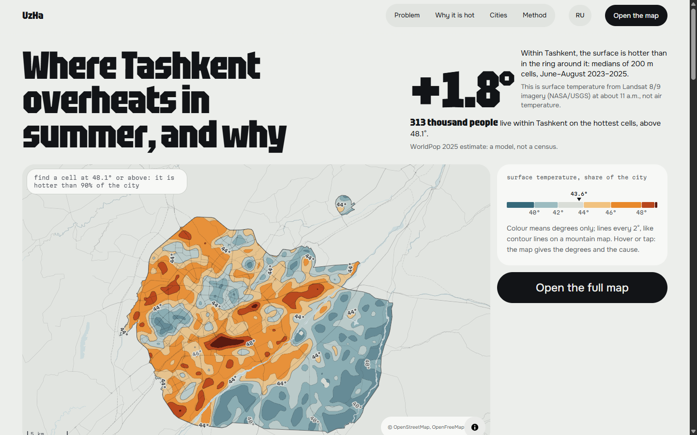
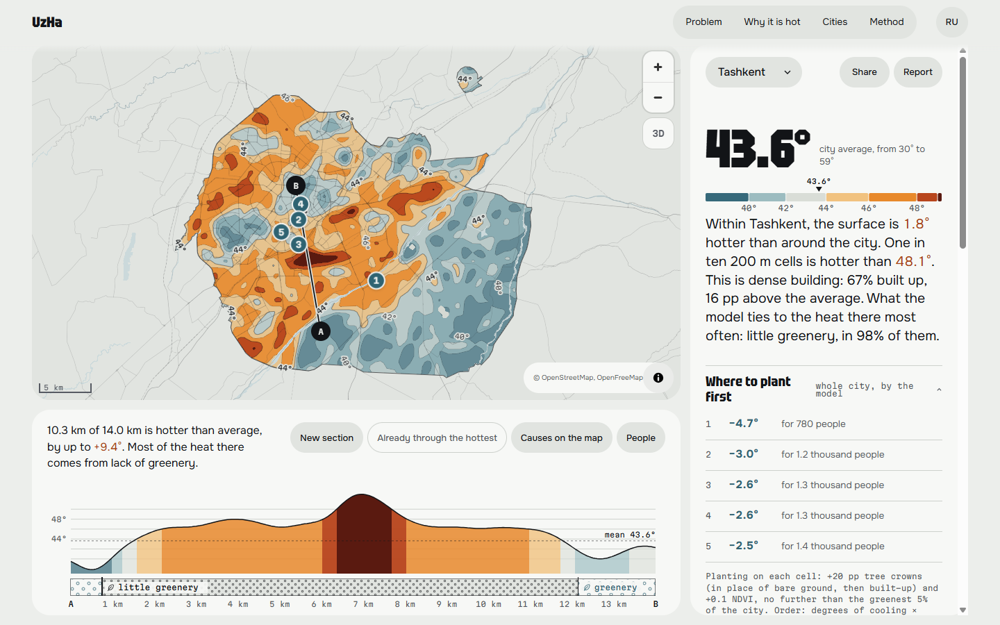

# Острова тепла: веб-приложение

Где город перегревается летом и почему. Карта изотерм температуры поверхности, разрез по линии А–Б с причинами
на каждом отрезке, панель с одним ответом (сколько здесь, что греет сильнее всего, что с этим сделать), 3D-город
с домами в цвете температуры и «что если»: модель города пересчитывает температуру участка прямо в браузере.

Читает только статические файлы (формат: `../docs/data-contract.md`). Бэкенда нет.





## Запуск

```bash
npm install
npm run mock   # синтетические данные, если пайплайн ещё не выгрузил настоящие; существующие файлы не трогает
npm run dev
npm test
npm run build
```

Данные лежат в `public/data/`: JSON городов, `model-<id>.json` для «что если» и `validation.json` (сверка с MODIS)
в git есть; файлы зданий `buildings/<id>.fgb` нет, их кладёт пайплайн, а без них 3D берёт дома подложки. Контуры
городов приезжают вместе с приложением: `public/boundaries/<id>.geojson`.

## Как устроено

- `src/data`: загрузка и проверка JSON по контракту, контур города.
- `src/domain`: чистая логика без React и MapLibre, покрыта тестами. Сетка ячеек в UTM, гладкая поверхность
  (апсемплинг, размытие), ступени изотерм и их контуры, выборка по разрезу и склейка отрезков по причине,
  тексты ответов, рекомендации, название места по подложке.
- `src/map`: MapLibre, стиль подложки, подписи изотерм поверх карты, снимок карты для отчёта; 3D-дома из `.fgb`
  по запросам диапазонов (`fileBuildings.ts`) или из подложки с окраской через feature state.
- `src/domain/whatIf.ts`: модель города в браузере (деревья XGBoost) и пределы ползунков «что если».
- `src/ui`: главная (`src/ui/landing`), инструмент, панель, разрез, штриховки причин.
- `src/report`: отчёт для печати (`window.print`).

Цвет на карте означает только температуру. Причины везде нарисованы штриховкой, как в легенде геологического разреза.

На карте: перетаскивание двигает карту, А и Б перетаскиваются, короткий щелчок выбирает место, Shift и протяжка
или кнопка «Новый разрез» рисуют новую линию. Esc возвращает к городу.

Стек: Vite, React, TypeScript, MapLibre GL, d3-contour, Vitest. Подложка: OpenFreeMap (OpenMapTiles).
Шрифты: Tektur, Onest и Martian Mono через Fontsource, токены те же, что у портфолио автора.

## Адреса

- `/`: главная. Живая карта Ташкента (под курсором градусы и причина, щелчок по горячему кварталу засчитывается),
  почему жарко, три города, что делать, как посчитали, команда.
- `/map/<id>`: карта целиком для города: изотермы, разрез, панель, отчёт.
- `/method/<id>`: как это посчитано.

Адреса без `#`, поэтому статический хостинг должен отдавать `index.html` на любой путь (SPA fallback).
Старые ссылки вида `#/city/<id>` по-прежнему открывают карту.

Скриншоты: `../docs/screenshots/`.
