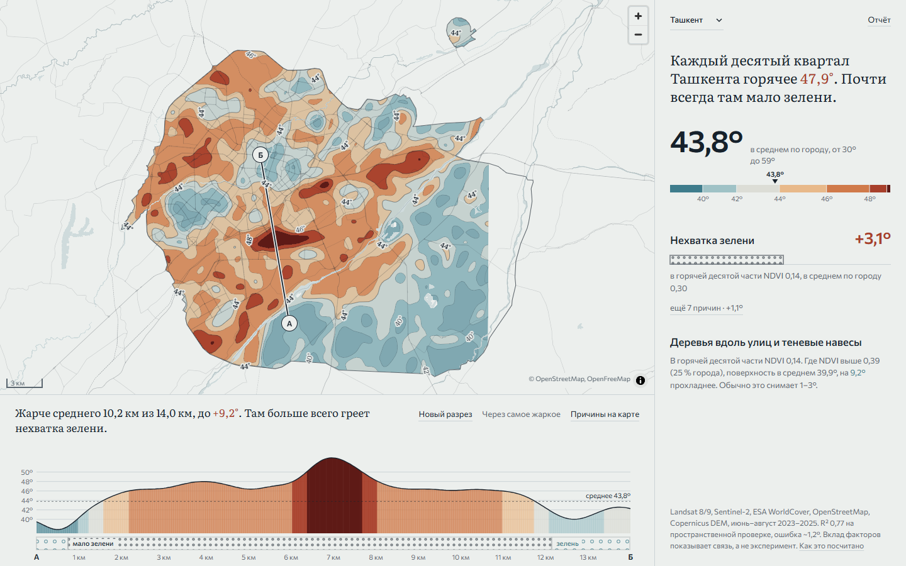

# Острова тепла: веб-приложение

Где город перегревается летом и почему. Карта изотерм температуры поверхности, разрез по линии А–Б с причинами
на каждом отрезке и панель с одним ответом: сколько здесь, что греет сильнее всего и что с этим сделать.

Читает только статические файлы (формат: `../docs/data-contract.md`). Бэкенда нет.



## Запуск

```bash
npm install
npm run mock   # синтетические данные, если пайплайн ещё не выгрузил настоящие; существующие файлы не трогает
npm run dev
npm test
npm run build
```

Данные городов лежат в `public/data/` (в git не попадают). Контуры городов приезжают вместе с приложением:
`public/boundaries/<id>.geojson`. Нет контура, карта просто не обрезается.

## Как устроено

- `src/data`: загрузка и проверка JSON по контракту, контур города.
- `src/domain`: чистая логика без React и MapLibre, покрыта тестами. Сетка ячеек в UTM, гладкая поверхность
  (апсемплинг, размытие), ступени изотерм и их контуры, выборка по разрезу и склейка отрезков по причине,
  тексты ответов, рекомендации, название места по подложке.
- `src/map`: MapLibre, стиль подложки, подписи изотерм поверх карты, снимок карты для отчёта.
- `src/ui`: экран города, панель, разрез, штриховки причин.
- `src/report`: отчёт для печати (`window.print`).

Цвет на карте означает только температуру. Причины везде нарисованы штриховкой, как в легенде геологического разреза.

На карте: перетаскивание двигает карту, А и Б перетаскиваются, короткий щелчок выбирает место, Shift и протяжка
или кнопка «Новый разрез» рисуют новую линию. Esc возвращает к городу.

Стек: Vite, React, TypeScript, MapLibre GL, d3-contour, Vitest. Подложка: OpenFreeMap (OpenMapTiles).
Шрифты: Literata и Commissioner через Fontsource.

Скриншоты: `../docs/screenshots/`.
